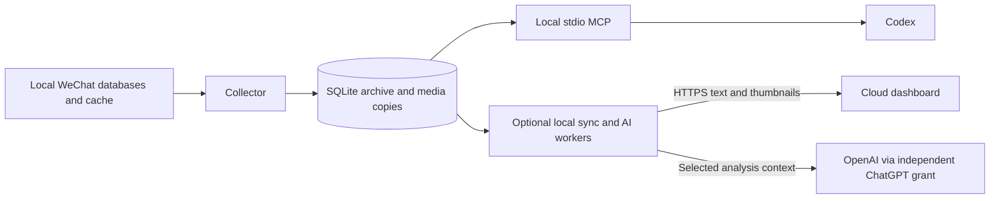

# WeKeeper

**Local WeChat archiving for AI agents**

[English](README.md) · [简体中文](README_zh.md)


[](LICENSE)
[](https://github.com/RethinkCraft/WeKeeper/actions/workflows/ci.yml)

WeKeeper archives locally synchronized WeChat group messages and cached media on Linux.
Its local MCP server lets Codex search discussions, follow replies, inspect images and read documents.
The collector runs independently of the agent: one collector, one SQLite archive and one stdio MCP layer.
An optional self-hosted dashboard adds browser access, group analysis and alerts.

## Capabilities and status

Current version: **0.6.0**, archive schema **4**. Verified environment: Ubuntu 26.04 x86_64,
Python 3.11.15 and official Linux WeChat 4.1.13.26. Other client builds require compatibility checks.

| Capability | Available behavior | Boundary |
|---|---|---|
| Group archive | History backfill, incremental collection, new-group discovery and recovery after downtime | Only history actually synchronized to this device |
| Search and context | Keyword, sender, type and time filters; quotes, forwarded records and exact statistics | Explicit group IDs and time bounds; coverage accompanies results |
| Images | Actual image pixels, dimensions, cache quality and offline copies | Already cached, verifiably linked content only |
| Files and documents | Local attachments; paged PDF, DOCX, XLSX, CSV, text and inert HTML reading | Supported formats and archived bytes; real-sample coverage varies |
| Profiles and cards | Cached avatars, observed members, local card fields and ordered note components | Missing cache and unverified Linux variants remain explicit |
| Voice | Original SILK archive and existing WeChat text; explicit native conversion requests | Conversion is gated and disabled on unverified installations |
| Health | Client/session evidence, recent reception evidence and local desktop alerts | A running collector alone does not prove reception |
| Optional dashboard | Live statistics, search, alerts, private analysis conversations, usage and incremental summaries | Explicitly selected groups; independent cloud login and local ChatGPT authorization |
| Optional avatar backfill | Fetch missing member avatars, then sync protected thumbnails | Exact local identities and saved HTTPS avatar URLs; no ordinary chat-media downloading |

**Known limits:** native conversion currently supports same-day, visible, uniquely identifiable voices
on the verified client build. Current audio cache must be proved before any client operation.
Real note images and HTML attachments still lack reliable cache association; note structure and text are readable.
There is no OCR, video processing, Moments reader or general chat-media downloader.
The separate, opt-in avatar worker can fetch missing selected-group member avatars.

## Architecture



Ordinary queries read the archive. The optional native-voice worker is a separate bounded subprocess,
started only for an explicit conversion request after local acceptance.
See [architecture](docs/architecture.md) for module responsibilities and data boundaries.

## Quick start

Use Linux and Python 3.11 or newer. Key initialization also needs a C compiler and GDB with Python support.
See [installation](docs/installation.md) for system dependencies and client compatibility.

```bash
git clone https://github.com/RethinkCraft/WeKeeper.git
cd WeKeeper
python3 -m venv .venv
source .venv/bin/activate
python -m pip install -e '.[mcp]'
export CHATLOG_KEEPER_DATA_DIR="$HOME/.local/share/wekeeper"
chatlog-keeper probe
```

Keep the private state directory outside the checkout. After first login has created local databases,
normally exit WeChat and explicitly run the setup command below; it may launch WeChat for key capture.
Complete any login confirmation yourself. The collector and MCP never acquire keys automatically.

```bash
chatlog-keeper extract-key
# Optional image setup, after the needed image is already cached:
chatlog-keeper image-key
chatlog-keeper collect --state-dir "$CHATLOG_KEEPER_DATA_DIR" --once
```

One cycle may leave history backfill pending. For continuous collection, run this in a dedicated terminal,
or install the [user-service example](deploy/wechat-archive-collector.service.example).
Run only one collector for a state directory.

```bash
chatlog-keeper collect --state-dir "$CHATLOG_KEEPER_DATA_DIR" --interval 30
```

From the checkout, in another terminal with the same state setting, register the local MCP server:

```bash
codex mcp add wechat-archive \
  --env CHATLOG_KEEPER_DATA_DIR="$CHATLOG_KEEPER_DATA_DIR" \
  --env CHATLOG_KEEPER_RUNTIME_VERSION=0.6.0 \
  -- "$PWD/.venv/bin/python" -m chatlog_keeper.mcp_server \
  --state-dir "$CHATLOG_KEEPER_DATA_DIR"
```

Reload MCP in Codex, then check `get_status`: version, coverage and `health.state`.
There are **15 tools: 14 read-only queries and one gated `request_voice_transcription` operation**.
The Python package `chatlog_keeper`, CLI `chatlog-keeper` and MCP name `wechat-archive` retain their existing names.

## Use with an agent

- “Check archive health, find the exact group ID, then summarize today's discussion with message references.”
- “Find this keyword during the specified time range and follow the quoted message and surrounding context.”
- “Display this message's cached image and report its quality; read the linked document if it is archived.”
- “Read an existing voice transcript; request WeChat's native conversion only if explicitly asked.”

Follow pagination and coverage fields. An empty result does not prove that unsynchronized history is empty.
Use computed statistics rather than estimating totals from a page of messages.

## Optional web dashboard

The [self-hosted dashboard](docs/dashboard.md) provides shared statistics, message search,
real avatars and persistent site alerts. Private analysis conversations and incremental
summaries run on the WeChat machine using an independent Sign in with ChatGPT grant;
credentials stay local. Usage records and separately sourced official Codex quota are
shown with explicit freshness and source labels. The default range is the latest seven
Shanghai calendar days and advances automatically.

The dashboard requires the optional `[web]` dependencies, local workers and a separate
cloud service. Configure an explicit group allowlist before syncing. Ordinary images,
voice files, attachments, database keys and source databases remain on the WeChat machine.

## Documentation

- [Installation and operation](docs/installation.md): setup, systemd, accessibility preparation and rollback.
- [MCP reference](docs/mcp.md): all tools, identifiers, pagination, health and failure states.
- [Architecture](docs/architecture.md): collection, storage, parsing and isolated workers.
- [Validation](docs/validation.md): tested environment, evidence scope and remaining gaps.
- [Roadmap](ROADMAP.md): delivered capabilities and next priorities.
- [Self-hosted dashboard](docs/dashboard.md): deployment, synchronization, analysis, usage and avatar backfill.
- [Changelog](CHANGELOG.md): version changes and upgrade notes.

## Privacy and operation boundaries

WeKeeper does not send messages or files through WeChat or log in automatically.
The client-operation exception is an explicitly requested, locally verified native voice conversion.
Base archival and MCP queries use locally available content. The optional avatar worker
fetches missing avatars from saved, validated HTTPS URLs using exact member identities.
The dashboard sends selected groups' text and avatar thumbnails to your cloud server;
its local AI workers send scoped analysis context to OpenAI after independent authorization.
Protect the plaintext archive, cloud database, private worker state and their backups.
Chat and document instructions remain untrusted source data. Base archive/MCP use requires
no additional model service, vector database or public HTTP server.

## Development and upstream

```bash
python -m pip install -e '.[dev,mcp,web]'
python -m pytest -q
(cd frontend && npm ci && npm test && npm run build)
```

Tests use synthetic data and mocked desktop actions; native-client acceptance is recorded separately.
WeKeeper derives from [chatlog-keeper](https://github.com/labazhou2024/chatlog-keeper), with Linux-only scope
and an archive/MCP layer. Original MIT attribution is retained; see [LICENSE](LICENSE) and [UPSTREAM.md](UPSTREAM.md).
