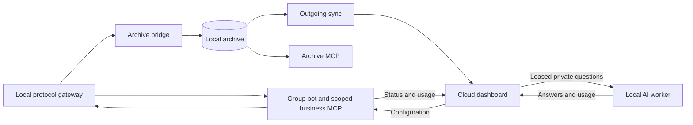

# WeKeeper

**WeChat message sync, private AI conversations, and protocol group bots.**

[English](README.md) · [简体中文](README_zh.md) · [MIT](LICENSE)

WeKeeper has two independently operated parts:

| Part | What it does |
|---|---|
| Dashboard and message sync | Sends selected groups' text and avatar thumbnails to your own server; provides search, statistics, alerts, private AI conversations, and usage records. |
| Group bot | Receives real mentions through a local protocol gateway, queries or reports business status through scoped MCP tools, and sends a reply quoting the triggering message. |

The shared foundation is a local SQLite archive, cached media reader, and fifteen-tool stdio MCP server. The bot uses the protocol gateway for message intake and sending. Automatic scheduled group summaries and the former UI-operated bot have been removed. You can still ask the AI to summarize a selected discussion in a private conversation.

## Requirements and compatibility

Version **0.7.0**. Python **3.11+**, Linux; Node **22** builds the dashboard. The native gateway has its own pinned Rust toolchain and ordered patch chain in [upstream.lock.json](deploy/protocol-gateway/upstream.lock.json).

Existing archive schema **4 and 5** remain at their existing version when opened for reading or writing. New archives use schema 5. The cloud dashboard uses schema **3**. The package, CLI and MCP identifiers remain `chatlog-keeper`, `chatlog_keeper`, and `wechat-archive`.

The official-client archive reader was verified with Ubuntu 26.04 x86_64 and Linux WeChat 4.1.13.26. Protocol transport compatibility is tied to the pinned gateway build. Offline tests alone do not establish phone receipt or compatibility with another client build.

## Architecture



Message collection, cloud sync, private questions and bot execution have independent queues. A cloud outage does not stop protocol reception. Credentials and ordinary chat media stay on the local machine; selected analysis text is sent to the configured model provider.

## Install

```bash
git clone https://github.com/RethinkCraft/WeKeeper.git
cd WeKeeper
python3 -m venv .venv
. .venv/bin/activate
python -m pip install -e '.[mcp,web,bot]'
export CHATLOG_KEEPER_DATA_DIR="$HOME/.local/share/wekeeper"
```

Keep private state outside source control. Follow [installation](docs/installation.md) to initialize an official-client archive and its cached keys. Local archive collection and the protocol bridge are alternative intake paths: use the intake selected for your deployment, with one owner of the account and archive writer.

## Dashboard, sync and private questions

```bash
wekeeper-dashboard --archive-state "$CHATLOG_KEEPER_DATA_DIR" groups
wekeeper-dashboard --archive-state "$CHATLOG_KEEPER_DATA_DIR" configure \
  --server-url https://YOUR_SERVER/wekeeper \
  --group group_REFERENCE --token-file /protected/machine-token
wekeeper-dashboard --archive-state "$CHATLOG_KEEPER_DATA_DIR" sync --once
```

Deploy the cloud service using [dashboard operation](docs/dashboard.md), then run the local `sync` and `agent` services. AI questions use the independent local Sign in with ChatGPT grant; model credentials are not uploaded. The dashboard's login is separate from that grant. Optional avatar backfill and official Codex quota sampling retain their existing boundaries.

There is no scheduled summarizer. See [upgrading](docs/upgrading.md) for removal of its old worker and data.

## Protocol group bot

Install and check the pinned gateway materials:

```bash
python scripts/setup_protocol_gateway.py --verify-lock
# With the pinned Rust toolchain installed:
python scripts/setup_protocol_gateway.py --build
```

Configure the gateway, account identity, group bindings, model and business permissions following [bot operation](docs/bot.md) and [gateway operation](docs/protocol-gateway.md). `wekeeper-bot check` validates explicit local paths without running a model or sending messages. `wekeeper-bot run` starts the protocol worker. First activation is explicit; ordinary restarts reuse the existing receive boundary.

The cloud bot page manages configuration after a deliberate initial alignment with the active local configuration. API keys remain local. Configuration changes are acknowledged by the local worker; disabling a group cancels unsent work. A gateway acceptance receipt and phone delivery are reported separately.

## Archive MCP

From an initialized archive, register the installed interpreter and private state:

```bash
codex mcp add wechat-archive \
  --env CHATLOG_KEEPER_DATA_DIR="$CHATLOG_KEEPER_DATA_DIR" \
  --env CHATLOG_KEEPER_RUNTIME_VERSION=0.7.0 \
  -- "$PWD/.venv/bin/python" -m chatlog_keeper.mcp_server \
  --state-dir "$CHATLOG_KEEPER_DATA_DIR"
```

There are fifteen tools: fourteen read-only queries and one explicitly requested, separately gated native voice transcription operation. Archive MCP does not gain bot sending permissions. Search, cached image/document reading, message references and coverage behavior are documented in [MCP reference](docs/mcp.md).

## Development and release

```bash
python -m pip install -e '.[dev,mcp,web,bot]' build
python -m pytest -q
(cd frontend && npm ci && npm test && npm run build -- --base=/wekeeper/)
python -m build
python scripts/check_release_artifacts.py dist/*
```

Default tests use synthetic records, temporary databases and mocked providers. Live protocol acceptance is separate and restricted to an explicitly authorized test group. Source distributions contain the frontend, deployment templates, tests and full gateway patch chain; wheels contain the Python runtime. CI verifies both from outside the checkout.

## Documentation

- [Installation](docs/installation.md) and [upgrade procedure](docs/upgrading.md)
- [Dashboard operation](docs/dashboard.md), [bot operation](docs/bot.md), [protocol gateway](docs/protocol-gateway.md)
- [Architecture](docs/architecture.md), [validation](docs/validation.md), [MCP reference](docs/mcp.md)
- [Changelog](CHANGELOG.md), [roadmap](ROADMAP.md), [upstream attribution](UPSTREAM.md)

Never publish private archives, account databases, model credentials, gateway tokens, logs or deployment backups. WeKeeper derives from [labazhou2024/chatlog-keeper](https://github.com/labazhou2024/chatlog-keeper); the original MIT attribution is retained.
