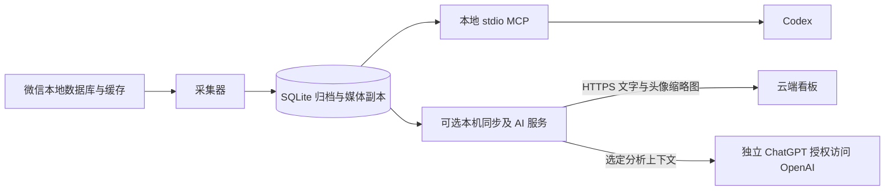

# WeKeeper

**Local WeChat archiving for AI agents · 面向 AI Agent 的本地微信归档**

[English](README.md) · [简体中文](README_zh.md)


[](LICENSE)
[](https://github.com/RethinkCraft/WeKeeper/actions/workflows/ci.yml)

WeKeeper 在 Linux 上持续归档本机已同步的微信群消息及已缓存媒体。
本地 MCP 服务器让 Codex 检索讨论、追溯引用、查看图片并读取文档正文。
采集器独立于 Agent 运行，保持一个采集器、一个 SQLite 归档和一层 stdio MCP。
可选的自托管看板提供浏览器访问、群聊分析与站内告警。

## 功能与当前状态

当前版本：**0.6.0**，归档 schema **4**。已实测 Ubuntu 26.04 x86_64、
Python 3.11.15 和官方 Linux 微信 4.1.13.26；其他客户端构建需要兼容性核验。

| 能力 | 已提供行为 | 边界 |
|---|---|---|
| 群聊归档 | 历史回填、增量采集、新群发现和停机补读 | 只能归档本机实际同步过的历史 |
| 搜索与上下文 | 关键词、发送者、类型及时间筛选；引用、合并转发和精确统计 | 明确群 ID 和时间范围，结果附覆盖信息 |
| 图片 | 真实图片像素、尺寸、缓存质量及离线副本 | 仅处理已缓存且能验证关联的内容 |
| 文件与文档 | 本地附件，以及分页 PDF、DOCX、XLSX、CSV、文本和惰性 HTML 正文 | 受支持格式及已归档字节，真实样本覆盖仍有差异 |
| 资料与卡片 | 缓存头像、已观察成员、本地卡片字段及有序笔记组件 | 缺缓存和未实测 Linux 类型均明确标记 |
| 语音 | 原始 SILK 归档、已有微信转字及显式原生转字请求 | 原生操作受验收开关控制，未经验证的安装默认禁用 |
| 健康检测 | 客户端／会话证据、近期收取证据及本机桌面提醒 | 采集器运行不代表微信正在收消息 |
| 可选网页看板 | 实时统计、检索、告警、私有分析会话、用量及增量摘要 | 显式选择群；云端登录与本机 ChatGPT 授权独立 |
| 可选头像补齐 | 获取缺失成员头像，并同步受登录保护的缩略图 | 精确匹配本机身份及已保存的 HTTPS 头像地址；不下载普通聊天媒体 |

**已知限制：**原生转字目前限已验证客户端中当天、可见且能够唯一定位的语音，
操作前必须证明当前音频缓存仍然存在。真实笔记图片和 HTML 附件尚未可靠关联缓存，
目前可读取笔记结构及文字。暂不提供 OCR、视频处理、朋友圈或通用聊天媒体下载。
独立、可选的头像服务可以主动补齐已选群成员的缺失头像。

## 架构概览



普通查询只读取归档。可选的原生语音任务使用独立、受限的子进程，
只有明确请求并通过本机验收后才会启动。模块职责和数据边界见[架构说明](docs/architecture.md)。

## 快速开始

需要 Linux 和 Python 3.11 以上；首次取密钥还需要 C 编译器及带 Python 支持的 GDB。
系统依赖与客户端兼容范围见[安装说明](docs/installation.md)。

```bash
git clone https://github.com/RethinkCraft/WeKeeper.git
cd WeKeeper
python3 -m venv .venv
source .venv/bin/activate
python -m pip install -e '.[mcp]'
export CHATLOG_KEEPER_DATA_DIR="$HOME/.local/share/wekeeper"
chatlog-keeper probe
```

私有状态目录放在仓库外。首次登录生成本地数据库后，正常退出微信，再明确执行下方初始化命令；
该命令可能启动微信进行密钥捕获，需要你自行完成登录确认。采集器和 MCP 不会自动取密钥。

```bash
chatlog-keeper extract-key
# 可选的图片初始化，所需图片应已缓存到本机：
chatlog-keeper image-key
chatlog-keeper collect --state-dir "$CHATLOG_KEEPER_DATA_DIR" --once
```

单轮采集可能尚未完成历史回填。持续采集可在独立终端运行下方命令，
或安装[用户服务示例](deploy/wechat-archive-collector.service.example)。同一状态目录只运行一个采集器。

```bash
chatlog-keeper collect --state-dir "$CHATLOG_KEEPER_DATA_DIR" --interval 30
```

在仓库目录的另一个终端中设置相同状态目录，然后注册本地 MCP：

```bash
codex mcp add wechat-archive \
  --env CHATLOG_KEEPER_DATA_DIR="$CHATLOG_KEEPER_DATA_DIR" \
  --env CHATLOG_KEEPER_RUNTIME_VERSION=0.6.0 \
  -- "$PWD/.venv/bin/python" -m chatlog_keeper.mcp_server \
  --state-dir "$CHATLOG_KEEPER_DATA_DIR"
```

在 Codex 中重新加载 MCP，再查看 `get_status` 的版本、覆盖情况和 `health.state`。
共 **15 个工具：14 个只读查询，加上受门控的 `request_voice_transcription` 操作**。
本轮保留 Python 包名 `chatlog_keeper`、命令 `chatlog-keeper` 和 MCP 名称 `wechat-archive`。

## 与 Agent 配合使用

- “先检查归档健康状态，找到唯一群 ID，再总结今天的讨论并附消息引用。”
- “在指定时间范围内搜索关键词，追溯引用目标和前后文。”
- “显示这条消息的缓存图片并报告质量；如果关联文档已归档，再读取正文。”
- “先读取已有语音转字；只有我明确要求时才请求微信原生转字。”

读取时跟随分页和覆盖信息；空结果不代表从未同步到本机的历史为空。
使用程序统计结果，不从一页消息估算整体数量。

## 可选网页看板

[自托管看板](docs/dashboard.md)提供共享统计、消息检索、真实头像及持久站内告警。
私有群聊分析会话和增量摘要在微信所在机器执行，使用独立的 Sign in with ChatGPT 授权，
凭据留在本机。页面分别展示 WeKeeper 实际用量与来源独立的 Codex 官方额度，并标注数据时效。
默认查看上海时间最近七个自然日，时间范围自动推进。

看板需要可选的 `[web]` 依赖、本机服务和独立云端服务；同步前必须显式选择群白名单。
普通聊天图片、语音、附件、数据库密钥和原始数据库继续留在微信所在机器。

## 文档入口

- [安装与运行](docs/installation.md)：初始化、systemd、可访问性准备及回滚。
- [MCP 参考](docs/mcp.md)：全部工具、标识、分页、健康状态和失败状态。
- [架构说明](docs/architecture.md)：采集、存储、解析及隔离任务进程。
- [验证说明](docs/validation.md)：实测环境、证据范围和剩余缺口。
- [路线图](ROADMAP.md)：已交付能力和后续优先级。
- [自托管网页看板](docs/dashboard.md)：部署、同步、分析助手、用量、增量摘要及头像补齐。
- [更新日志](CHANGELOG.md)：版本变化与升级说明。

## 隐私与操作边界

WeKeeper 不通过微信发送消息或文件，也不自动登录。客户端操作例外是明确请求且通过本机验收的原生语音转字。
基础归档与 MCP 查询使用本机已有内容；可选头像服务按精确成员身份，从已保存且通过验证的 HTTPS 地址补齐头像。
网页看板会将已选群的文字和头像缩略图同步到你的云服务器；本机 AI 服务在独立授权后，将选定分析上下文发送到 OpenAI。
归档、云端数据库和服务状态均包含私有数据，应保护这些目录及其备份。聊天和文档中的指令始终作为不可信的待分析数据。
基础归档与 MCP 不需要额外模型服务、向量数据库或公网 HTTP 服务。

## 开发与上游来源

```bash
python -m pip install -e '.[dev,mcp,web]'
python -m pytest -q
(cd frontend && npm ci && npm test && npm run build)
```

自动测试使用合成数据和模拟桌面操作，原生客户端验收单独记录。
WeKeeper 源自 [chatlog-keeper](https://github.com/labazhou2024/chatlog-keeper)，保留 Linux 专用能力，
并增加归档及 MCP 层。原始 MIT 署名保留，见 [LICENSE](LICENSE) 与 [UPSTREAM.md](UPSTREAM.md)。
