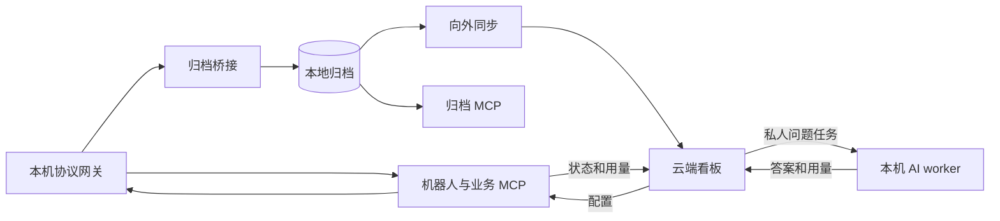

# WeKeeper

**微信群消息同步、私人 AI 对话与协议群机器人。**

[English](README.md) · [简体中文](README_zh.md) · [MIT](LICENSE)

项目分为两个可独立运行的板块：

| 板块 | 功能 |
|---|---|
| 云端看板与消息同步 | 将选定群的文字、头像缩略图同步到自有服务器，提供搜索、统计、告警、私人 AI 问答及用量记录。 |
| 群机器人 | 通过本机协议网关接收真实 @，使用限定权限的业务 MCP 查询或报备状态，再引用触发消息回复。 |

共享底座包括本地 SQLite 归档、缓存媒体读取和十五工具的 stdio MCP。机器人统一使用协议网关收发。定时群聊自动总结、旧版 UI 机器人及 pilot 镜像已退出；仍可在私人对话中主动要求 AI 总结指定讨论。

## 环境与兼容

当前版本 **0.7.0**，需要 Linux、Python **3.11+**；前端使用 Node **22** 构建。原生协议网关使用独立固定的 Rust 工具链及补丁链，见 [upstream.lock.json](deploy/protocol-gateway/upstream.lock.json)。

已有归档 schema **4、5** 均按原版本读写，新建归档为 schema 5；云端看板为 schema **3**。Python 包名 `chatlog_keeper`、发行名 `chatlog-keeper`、三个 CLI 和 MCP 名称 `wechat-archive` 保持稳定。

官方客户端归档读取的已验证环境为 Ubuntu 26.04 x86_64、Linux 微信 4.1.13.26。协议收发与固定网关版本绑定；离线测试通过不代表其他客户端兼容或手机端收件验收通过。

## 架构



归档、同步、私人问答及机器人分别维护队列。云端暂时不可用时，协议网关继续接收消息。模型凭据和普通聊天媒体留在本机；被选中的分析文本会发送给配置的模型供应商。

## 安装

```bash
git clone https://github.com/RethinkCraft/WeKeeper.git
cd WeKeeper
python3 -m venv .venv
. .venv/bin/activate
python -m pip install -e '.[mcp,web,bot]'
export CHATLOG_KEEPER_DATA_DIR="$HOME/.local/share/wekeeper"
```

私有状态应放在版本控制之外。官方客户端归档初始化和缓存密钥准备见 [安装说明](docs/installation.md)。官方客户端采集与协议归档桥接是两种接入方式，按部署选择，账号及归档写入保持单一所有者。

## 看板、同步与 AI 问答

```bash
wekeeper-dashboard --archive-state "$CHATLOG_KEEPER_DATA_DIR" groups
wekeeper-dashboard --archive-state "$CHATLOG_KEEPER_DATA_DIR" configure \
  --server-url https://YOUR_SERVER/wekeeper \
  --group group_REFERENCE --token-file /protected/machine-token
wekeeper-dashboard --archive-state "$CHATLOG_KEEPER_DATA_DIR" sync --once
```

依照 [看板部署说明](docs/dashboard.md) 启动云端，再运行本机 `sync` 与 `agent` 服务。私人问答复用独立保存在本机的 Sign in with ChatGPT 授权；看板登录与此授权相互独立。头像补全和官方 Codex 额度采样保留原有功能边界。

项目不再运行定时总结。旧版总结服务及数据清理步骤见 [升级说明](docs/upgrading.md)。

## 协议群机器人

```bash
python scripts/setup_protocol_gateway.py --verify-lock
# 安装固定 Rust 工具链后再构建：
python scripts/setup_protocol_gateway.py --build
```

按 [机器人运行说明](docs/bot.md) 和 [协议网关说明](docs/protocol-gateway.md) 设置网关、账号、群绑定、模型与业务权限。`wekeeper-bot check` 只检查明确指定的本机路径，不运行模型或发消息；`wekeeper-bot run` 启动协议处理。首次激活单独执行，普通重启沿用已有收件边界。

首次启用云端机器人管理时，先将当前本机生效配置对齐到云端，再接受新修改。密钥只保存在本机。配置由本机确认应用后生效；关闭群会取消尚未发送的工作。看板明确区分网关受理与手机端收件。

## 归档 MCP

初始化归档后，可注册本机解释器和私有状态目录：

```bash
codex mcp add wechat-archive \
  --env CHATLOG_KEEPER_DATA_DIR="$CHATLOG_KEEPER_DATA_DIR" \
  --env CHATLOG_KEEPER_RUNTIME_VERSION=0.7.0 \
  -- "$PWD/.venv/bin/python" -m chatlog_keeper.mcp_server \
  --state-dir "$CHATLOG_KEEPER_DATA_DIR"
```

保留十五个工具：十四个只读查询，以及一个需要明确请求和单独验收的原生语音转文字操作。归档 MCP 不获得机器人发消息能力。消息引用、覆盖范围、缓存图片及文档读取见 [MCP 参考](docs/mcp.md)。

## 开发与发布准备

```bash
python -m pip install -e '.[dev,mcp,web,bot]' build
python -m pytest -q
(cd frontend && npm ci && npm test && npm run build -- --base=/wekeeper/)
python -m build
python scripts/check_release_artifacts.py dist/*
```

默认回归使用合成数据、临时数据库和模拟供应商。真实微信验收单独执行，限明确授权的测试群。源码包包含前端、部署模板、测试和完整网关补丁链；wheel 包含 Python 运行时。CI 会在仓库外验证源码包和 wheel。

## 文档

- [安装运行](docs/installation.md)、[升级流程](docs/upgrading.md)
- [看板部署](docs/dashboard.md)、[机器人](docs/bot.md)、[协议网关](docs/protocol-gateway.md)
- [架构](docs/architecture.md)、[验证边界](docs/validation.md)、[MCP](docs/mcp.md)
- [更新记录](CHANGELOG.md)、[路线图](ROADMAP.md)、[上游归属](UPSTREAM.md)

不要发布归档、账号数据库、模型凭据、网关 token、日志或部署备份。项目衍生自 [labazhou2024/chatlog-keeper](https://github.com/labazhou2024/chatlog-keeper)，保留原 MIT 许可与署名。
