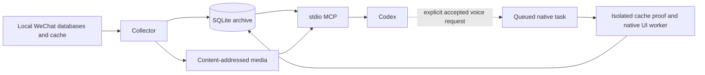

# Architecture

WeKeeper keeps one collector, one private SQLite archive and one local stdio MCP
layer. There is no HTTP server, separate AI analysis service, vector database or
distributed job system. Codex performs analysis after requesting scoped evidence.



## Source and collection boundary

Discovery and key initialization are separate from ordinary collection. Explicit
setup commands save only account-bound, HMAC-verified material. The collector
and MCP never automatically acquire keys, start WeChat or log in.

For each changed message shard, the collector creates one stable decrypted
snapshot and reads its group tables in batches. Source row identity, not message
time, advances the collection checkpoint. New rows are prioritized; independent
backfill and daily reconciliation resume after interruption. New groups and
shards are discovered automatically. Source reset/reuse starts a new generation
without erasing old archived data.

Message insertion and checkpoint updates commit in the same transaction.
SQLite WAL permits archive queries during collection. A collector lock rejects
another collection instance for the same state. Temporary plaintext snapshots
are private, bounded and cleaned after use; unparsed and unknown payloads remain
available in the private archive for later reparsing.

Cached `VoiceInfo` audio and `head_image.db` images enrich existing identities.
Their snapshots, progress and errors remain separate from message checkpoints.
An auxiliary failure cannot prevent text archival or become false evidence of
new message reception.

## Archive and media model

Stable message references bind account, group, server identity and source
provenance. Raw origins, structured content, reply relations, media state and
parser version are retained. Same-second or late messages are not skipped by
timestamp watermarks. Missing server IDs are preserved conservatively when
cross-generation deduplication cannot be proved.

The archive includes local member/profile snapshots, avatar versions, forwarded
items, ordered card components, original voice assets, native transcript versions
and task records. Quotes, forwarded entries, note components and transcripts do
not count as additional top-level group messages or actual group participants.

Media uses content-addressed copies of already cached bytes and any verified
decoded image. Precise identity/content evidence is required for association;
filenames or visual similarity are insufficient. Full cache, thumbnail,
unresolved, missing, corrupt and unsupported states remain distinct. Existing
decoding material is retained when new settings arrive. Source cache cleanup
does not invalidate a good archive copy.

All business storage remains in the selected private state:

```text
STATE_DIR/
├── archive/
│   ├── archive.sqlite
│   ├── media/
│   └── backups/
└── secrets/
```

Operational lock/metadata files and optional accessibility preparation records
also live in private state. These paths are implementation storage, not MCP
reference inputs. The repository contains no account state or client binaries.

## Queries and short-lived workers

Ordinary MCP tools open the archive read-only. Reads, searches and statistics
require explicit groups and times. FTS5 trigram search handles suitable terms;
short Chinese terms use bounded substring matching. Optional transcript/card/
forwarded indexes return the parent message and match provenance. Derived index
changes do not invalidate ordinary message identity or inflate counts.

Paging is bounded by item count and output size. Cursors bind query scope and
the relevant snapshot/revision. Source/coverage gaps remain visible instead of
being represented as an empty, supposedly complete history.

Document extraction is an isolated worker consuming verified archive bytes. It
has input, expansion, text/output, CPU, memory and wall-clock limits. HTML is
parsed as inert text, formulas are not evaluated, and no renderer or external
fetch path exists. These resource limits are not an operating-system network
sandbox.

The optional native conversion queue is independent of the 30-second collector
poll. A single task runs in an isolated child with a 90-second deadline, bounded
pipes, parent-exit protection and a UI lock. Before any conversion, a companion
read-only process authenticates the current cached audio and verifies its identity
and hash. The reviewed UI path checks account, group, sender, time and duration;
ambiguous or changed targets stop. Results come from WeChat's native accessibility
text and are saved separately. Querying does not trigger a task.

## Module map

| Area | Main modules |
|---|---|
| CLI and MCP | `cli.py`, `mcp_server.py` |
| Collection | `collector.py`, `p2_sources.py` |
| Archive and structured semantics | `archive.py`, `archive_semantics.py`, `archive_p2.py`, `message_model.py` |
| Cached media and documents | `archive_media.py`, `documents.py`, `document_extractors.py`, `document_worker.py` |
| Native voice tasks | `native_transcription.py`, `native_accessibility.py`, `native_cache_probe.py` |
| Session health and alerts | `client_health.py`, `health_alerts.py` |
| Linux/source adapters | `wechat_db.py`, `wechat_contacts.py`, `wechat_image.py`, key modules and `core/` |

The existing `chatlog_keeper/` and flat `tests/` layouts are retained for the
0.5.0 publication. This packaging pass does not introduce a second runtime or
rename stable package, CLI or MCP interfaces.

## Trust and compatibility

The archive stores plaintext private content; protect the whole state directory
and its backups. MCP filters key material, raw payload fields and private URLs
from ordinary output. Selected content still enters the requesting model's
context, so chat text and document instructions remain untrusted data.

Client UI presence and network availability do not prove WeChat server
connectivity. Health combines those observations with actual recent ordinary
message ingestion; a transcription/index update never counts as reception.
The tested client and outstanding media/type gaps are described in
[validation](validation.md), with future work in [the roadmap](../ROADMAP.md).
